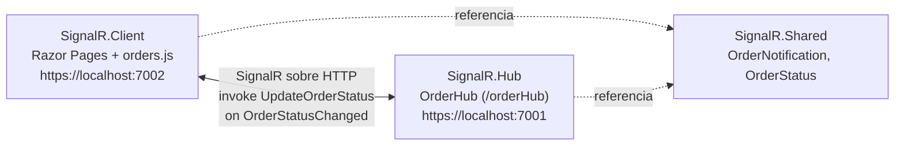

# Pedidos en vivo con SignalR y .NET 10

Reto independiente del taller *Aplicaciones en tiempo real con SignalR y .NET 10*.
Cada cambio de estado de un pedido (**Pendiente → En preparación → Enviado → Entregado**) se notifica a todos los navegadores conectados, sin recargar la página.

## Arquitectura



También se incluye el diagrama como imagen: `arquitectura.svg`.

| Proyecto | Plantilla | Responsabilidad |
|---|---|---|
| `SignalR.Hub` | `webapi` | Aloja `OrderHub`, valida los datos y distribuye el evento |
| `SignalR.Client` | `webapp` | Interfaz web (Razor Pages) y cliente JavaScript |
| `SignalR.Shared` | `classlib` | Contratos compartidos: `OrderNotification` y `OrderStatus` |

El navegador no importa clases de .NET: `OrderNotification` se serializa a JSON y llega a JavaScript como un objeto (`notification.orderId`, `notification.status`, `notification.changedAt`).

## Requisitos

- SDK de .NET 10 (`dotnet --version` debe empezar por `10`)
- PowerShell y un navegador moderno
- Conexión a internet la primera vez (LibMan descarga la librería de SignalR)
- Herramienta LibMan: `dotnet tool install -g Microsoft.Web.LibraryManager.Cli`

## Pasos de ejecución

Desde la raíz de la solución:

```powershell
# 1. Restaurar la librería JavaScript de SignalR (una vez)
cd SignalR.Client
libman restore
cd ..

# 2. Compilar
dotnet restore
dotnet build
```

Abrir **dos terminales**.

**Terminal 1 (servidor, debe quedar corriendo):**

```powershell
dotnet run --project SignalR.Hub --urls https://localhost:7001
```

**Terminal 2 (cliente):**

```powershell
dotnet run --project SignalR.Client --urls https://localhost:7002
```

Abrir `https://localhost:7002` en **dos pestañas**. Debe aparecer "Conectado". Escribir un número de pedido (por ejemplo `PED-001`), elegir un estado y pulsar **Actualizar estado**: la línea aparece en las dos pestañas.

Si el navegador desconfía del certificado HTTPS:

```powershell
dotnet dev-certs https --trust
```

### Valores que deben coincidir

| Elemento | Valor |
|---|---|
| Puerto del servidor | 7001 |
| Puerto del cliente | 7002 |
| Endpoint del Hub | `/orderHub` |
| Método invocado por el cliente | `UpdateOrderStatus` |
| Evento enviado por el servidor | `OrderStatusChanged` |
| Origen permitido en CORS | `https://localhost:7002` |

Si se cambia un puerto, hay que actualizar CORS en `Hub/Program.cs` y la URL en `wwwroot/js/orders.js`.

## Flujo de comunicación

1. El cliente abre la conexión con `withUrl("https://localhost:7001/orderHub")`.
2. El usuario envía el formulario y JavaScript ejecuta `connection.invoke("UpdateOrderStatus", orderId, status)`.
3. `OrderHub` valida los datos, crea un `OrderNotification` con la hora UTC y llama a `Clients.All.SendAsync("OrderStatusChanged", notification)`.
4. Todos los clientes reciben el evento en `connection.on("OrderStatusChanged", ...)` y agregan la línea a la lista usando `textContent`.

## Validaciones y manejo de errores

Servidor (`OrderHub`), que es la validación que cuenta:

- El número de pedido no puede estar vacío.
- Se recortan los espacios (`Trim`).
- Máximo 40 caracteres.
- El estado debe ser un valor definido del `enum` (`Enum.IsDefined`).
- Si algo falla se lanza `HubException` y el cliente lo muestra con `alert`.

Cliente:

- Valida que el pedido no esté vacío antes de enviar.
- Comprueba que la conexión esté en estado `Connected`.
- Deshabilita el botón mientras reconecta (`withAutomaticReconnect`) y muestra el estado de la conexión.
- Usa `textContent` en lugar de `innerHTML`, por lo que el contenido nunca se interpreta como HTML.

Los estados viajan como texto (`"EnPreparacion"`) gracias a `JsonStringEnumConverter` configurado en `AddSignalR`.

## Cómo integraría SignalR con una API REST

SignalR no reemplaza a la API: se reparten el trabajo.

- **API REST**: operaciones CRUD y persistencia. Es la fuente de verdad (base de datos).
- **SignalR**: distribuye en tiempo real el cambio que ya ocurrió.

Flujo propuesto:

1. Un sistema o usuario llama a `PUT /orders/{id}/status`.
2. La API valida, guarda el cambio en la base de datos y verifica que la transición sea válida.
3. Después de guardar, la API usa `IHubContext<OrderHub>` para emitir el evento a los clientes conectados.
4. Los navegadores se actualizan sin recargar. Al abrir la página, cargan el estado actual con un `GET /orders` y luego solo escuchan los cambios.

```csharp
app.MapPut("/orders/{id}/status", async (
    string id,
    OrderStatus status,
    IHubContext<OrderHub> hub) =>
{
    // 1. Validar y guardar en la base de datos (EF Core, por ejemplo)
    // 2. Notificar solo cuando el guardado fue exitoso
    var notification = new OrderNotification(id, status, DateTimeOffset.UtcNow);
    await hub.Clients.All.SendAsync("OrderStatusChanged", notification);
    return Results.NoContent();
});
```

Con esto el Hub deja de ser quien decide y pasa a ser solo el canal de notificación, y los cambios sobreviven a reinicios porque quedan persistidos.

## Autenticación y autorización propuestas

Hoy el pedido y el estado llegan desde el navegador y cualquiera podría invocar `UpdateOrderStatus`. En producción:

1. **Autenticar** al usuario con JWT (o cookies si la web y el Hub comparten dominio).
2. **Proteger el Hub** con `[Authorize]`.
3. **Autorizar por rol o política**: solo el personal autorizado puede cambiar estados; los clientes solo reciben.
4. **Identificar con `Context.User`**, nunca con un nombre escrito en el formulario.
5. **Destinatarios por identidad**: el cliente solo recibe sus pedidos usando `Clients.User(userId)` o grupos (`Groups.AddToGroupAsync`) por cliente o por pedido, en lugar de `Clients.All`.

```csharp
// Program.cs
builder.Services.AddAuthentication(JwtBearerDefaults.AuthenticationScheme)
    .AddJwtBearer(options =>
    {
        // Los WebSockets no pueden enviar cabeceras: el token viaja en la query
        options.Events = new JwtBearerEvents
        {
            OnMessageReceived = context =>
            {
                var token = context.Request.Query["access_token"];
                if (!string.IsNullOrEmpty(token) &&
                    context.HttpContext.Request.Path.StartsWithSegments("/orderHub"))
                {
                    context.Token = token;
                }
                return Task.CompletedTask;
            }
        };
    });

builder.Services.AddAuthorization(options =>
    options.AddPolicy("Operador", p => p.RequireRole("Operador")));

app.UseAuthentication();
app.UseAuthorization();

// OrderHub.cs
[Authorize]
public sealed class OrderHub : Hub
{
    [Authorize(Policy = "Operador")]
    public async Task UpdateOrderStatus(string orderId, OrderStatus status) { /* ... */ }

    public override async Task OnConnectedAsync()
    {
        await Groups.AddToGroupAsync(Context.ConnectionId, $"user-{Context.UserIdentifier}");
        await base.OnConnectedAsync();
    }
}
```

```javascript
// orders.js
.withUrl("https://localhost:7001/orderHub", {
    accessTokenFactory: () => obtenerToken()
})
```

## Limitaciones de esta versión

- No hay almacenamiento persistente: al cerrar la página el historial mostrado desaparece.
- No hay autenticación; el sistema notifica a todos con `Clients.All`.
- No se valida el orden de las transiciones de estado (por ejemplo, de Pendiente a Entregado).
- La versión `8.0.7` de `@microsoft/signalr` en `libman.json` es la del taller; en producción se fija una versión probada y nunca `latest`.

## Capturas de la ejecución

Agregar aquí las imágenes (carpeta `capturas/`):

1. Las dos pestañas con el estado "Conectado".
2. Un cambio enviado en la pestaña 1 y visible en la pestaña 2.
3. El error de validación (pedido vacío o demasiado largo).
4. Las dos terminales con el Hub y el cliente corriendo.

## Entregables

- [x] Código fuente (tres proyectos)
- [x] README con los pasos de ejecución
- [x] Diagrama de arquitectura (`arquitectura.svg`)
- [ ] Capturas de la ejecución
- [ ] Demostración funcional
